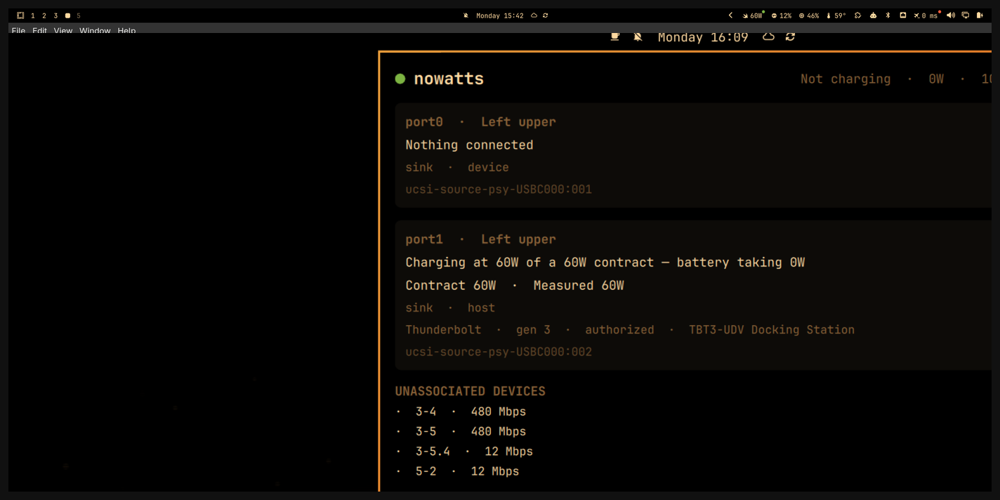

# nowatts

> **now: watts** — live USB-C power status for your Omarchy bar.
> When it's **"no watts?!"**, nowatts tells you why.

A Rust daemon + Omarchy shell widget that reads what the Linux kernel already
knows about your USB-C ports and says it in plain English — the
[WhatCable](https://github.com/darrylmorley/whatcable) idea, built for Linux.
No cable chips required: slow-charge detection comes from the negotiated PD
contract plus real battery behavior.



*Bar: plug glyph + live watts · Panel: one plain-English card per port.*

**Status: v1 working on this machine** — daemon live as a systemd `--user`
service, widget live in the bar. See [PLAN.md](PLAN.md) for the remaining
verification queue and [SPEC.md](SPEC.md) "Success criteria".

## What it shows

- Per-port plain-English cards: *"Nothing connected"* · *"Charging at 65W of a
  100W contract — battery taking 17.4W"* · *"Device connected (USB 480)"* ·
  *"Display connected"*
- Live charging wattage in the bar (plug glyph + W)
- Slow-charge warning: *"On AC but the battery is draining — charger or cable
  is too weak"*
- Thunderbolt/USB4 link status, DisplayPort connectors

## Architecture

```
nowatts  (Rust daemon · systemd --user service · no async runtime)
  ├─ blocks on kernel uevents (udev crate) + 30s heartbeat rescan
  ├─ reads sysfs: typec, power_supply, usb, thunderbolt, drm
  ├─ computes plain-English verdicts (pure, fixture-tested)
  └─ writes ~/.local/state/nowatts/status.json   (atomic, on change)

legend.nowatts  (Omarchy shell bar widget · thin QML)
  ├─ FileView reads status.json on a ~1s timer
  ├─ bar: plug glyph + live watts
  └─ panel: one plain-English card per port
```

The contract between the halves is the entire interface: see
[CONTRACT.md](CONTRACT.md).

## Install

```sh
./install.sh
```

Builds the daemon (Rust, `mise use rust`), installs the binary to
`~/.local/bin/`, the systemd `--user` unit, and the widget to
`~/.config/omarchy/plugins/legend.nowatts/`, then enables both. Re-run to
update. Manual steps are in [PLAN.md](PLAN.md) P1a.8 / P1b.1.

## Deployment paths (target)

| piece | location |
|---|---|
| daemon binary | `~/.local/bin/nowatts` |
| user unit | `~/.config/systemd/user/nowatts.service` |
| state | `~/.local/state/nowatts/status.json` |
| widget | `~/.config/omarchy/plugins/legend.nowatts/` |

## Name

**nowatts** — reads both ways on purpose: *"now: watts"* is the bar readout,
*"no watts?!"* is the warning state. Collision-checked 2026-10-19;
`wattbar` (Mac menu bar power monitor) and `wattson` (energy-monitor
hardware) were taken or crowded. Details in [RESEARCH.md](RESEARCH.md).

```
RESEARCH.md        verified sysfs map + constraints + Omarchy conventions
SPEC.md            stories, requirements, success criteria
CONTRACT.md        status.json v1 — the daemon↔widget interface
PLAN.md            verification queue for what's left
install.sh         build + install daemon, unit, and widget
nowatts/           Rust crate — sysfs reader, model, atomic writer, watcher
plugin/            Omarchy shell widget (legend.nowatts) + preview.png
nowatts.service    systemd --user unit
```

## Hardware this was scoped on

ThinkPad X1 Carbon Gen 13 (Core Ultra 7 258V, Lunar Lake), Omarchy 4.0.4,
kernel 7.2.5-3-omarchy, two USB-C ports over UCSI. [RESEARCH.md](RESEARCH.md)
has the exact sysfs map — and the two things this hardware cannot do (cable
e-markers, charger PDO lists), which is why they're out of scope.
